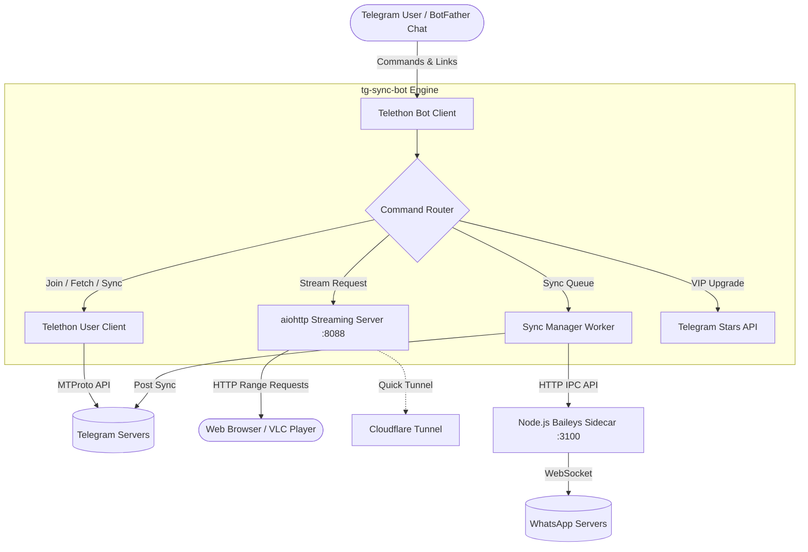

# tg-sync-bot — Telegram Channel Joiner, Downloader & Real-Time Sync Bot

[](https://www.python.org/)
[](https://docs.telethon.dev/)
[](https://nodejs.org/)
[](https://github.com/WhiskeySockets/Baileys)
[](https://opensource.org/licenses/MIT)

A hybrid Telegram bot and user client built with **Telethon** and **Node.js (Baileys)**. Interact with your **@BotFather** bot while your connected **Telegram User Account** automatically:

1. **Joins Channels**: Handles public `@username` handles and private `t.me/+...` invite links seamlessly.
2. **Downloads & Forwards**: Bypasses content-restricted (`noforwards`) channels to download or copy media, preserving original filenames, captions, and thumbnails.
3. **Streams Videos**: Built-in HTTP server with Range-request support and optional Cloudflare quick tunnels for instant video playback without waiting for full downloads.
4. **Bulk Uploads**: Upload or forward post batches directly to target **Telegram Channels** or **WhatsApp Groups**.
5. **Real-Time Auto-Sync**: Continuously monitors Telegram channels and syncs new posts in real-time to other Telegram channels or WhatsApp groups.
6. **Tier System & Telegram Stars**: Built-in Free and VIP tiers with Telegram Stars (`50 XTR`) invoice checkout and admin controls.

---

## Table of Contents

- [Features](#features)
- [Architecture & Workflow](#architecture--workflow)
- [Requirements](#requirements)
- [Installation](#installation)
- [Configuration](#configuration)
  - [Environment Variables](#environment-variables)
- [Running the Bot](#running-the-bot)
  - [WhatsApp Sidecar Pairing](#whatsapp-sidecar-pairing)
  - [Running as a Systemd Service](#running-as-a-systemd-service)
- [Command Reference](#command-reference)
  - [General & Interactive Menu](#general--interactive-menu)
  - [Download & Video Streaming](#download--video-streaming)
  - [Telegram Channel Forwarding (`/tg`)](#telegram-channel-forwarding-tg)
  - [WhatsApp Group Upload (`/wa`)](#whatsapp-group-upload-wa)
  - [Real-Time Auto-Sync (`/sync` & `/tgsync`)](#real-time-auto-sync-sync--tgsync)
  - [Paid VIP & Administration](#paid-vip--administration)
- [Running Tests](#running-tests)
- [License & Disclaimer](#license--disclaimer)

---

## Features

### 🔗 Channel Joiner & Management
- Join public channels by `@username` or `https://t.me/username`.
- Join private channels via `https://t.me/+InviteHash`, `https://t.me/joinchat/InviteHash`, or `tg://join?invite=InviteHash`.
- Batch join multiple channels with configurable rate-limit delays (`JOIN_DELAY_SECONDS`).
- Leave joined channels effortlessly via `/leave <channel>`.

### 📥 High-Speed File & Media Downloader
- Multi-connection parallel chunk downloading via `fast_telethon.py`.
- Download single posts (`https://t.me/c/1234567890/5`) or batch ranges (`https://t.me/c/1234567890/5-20`).
- **Restricted Content (`noforwards`) Support**: Automatically grabs protected media and re-uploads cleanly.
- Live progress bars indicating percentage, download/upload speed (`MB/s`), and estimated time.

### 🎥 HTTP Video Streaming Server (`stream_server.py`)
- Direct video streaming from Telegram via HTTP chunked range requests (`Range: bytes=start-end`).
- Built-in web video player for browser playback.
- Optional automatic **Cloudflare Tunnel (`cloudflared`)** integration to expose streaming links over HTTPS without port forwarding.

### ✈️ Telegram Channel Uploader (`/tg`)
- Bulk download/copy posts from source channels directly into a target Telegram channel or group.
- Preserves original metadata, formatting, and captions.

### 📲 WhatsApp Group Uploader (`/wa`)
- Powered by a local Node.js sidecar (`wa_sidecar/`) running [Baileys](https://github.com/WhiskeySockets/Baileys) as a linked device.
- Uploads videos, images, audio, and documents (up to 2 GB) with original captions.
- Includes pairing via QR code or numeric phone pairing code.

### 🔄 Real-Time Channel Auto-Sync (`/sync` & `/tgsync`)
- Live event listening + background fallback polling for 100% sync reliability.
- Syncs Telegram ➔ Telegram Channel, Telegram ➔ WhatsApp Group, or both simultaneously.
- Catchup feature (`/sync catchup <rule_id> [count]`) to backfill past posts.
- Fully persistent configuration (`sync_config.json`) surviving bot restarts.

### 💎 Tier Management & Telegram Stars Payments
- **Free Plan**: Unlimited channel joins, single/bulk downloads, video streaming (`/stream`), `/tg` uploads, and 1 Telegram-to-Telegram Auto-Sync rule.
- **Paid VIP Plan**: WhatsApp Auto-Sync & Bulk Upload (`/sync` & `/wa`), and unlimited Telegram Auto-Sync rules.
- **Telegram Stars (50 XTR)** invoice checkout for 1-month VIP access, stored with SQLite idempotency (`payments.sqlite3`).

---

## Architecture & Workflow



---

## Requirements

- **Linux / macOS / Windows**
- **Python 3.10+**
- **Node.js 20+** and `npm` (required for WhatsApp sidecar)
- **`ffmpeg`** *(Recommended)*: For fast MP4 atom remuxing (`+faststart`) and video thumbnail extraction.
- **`cloudflared`** *(Optional)*: For automatic public streaming tunnels.

---

## Installation

### 1. Clone the Repository
```bash
git clone https://github.com/tharushatheekshana/tg-sync-bot.git
cd tg-sync-bot
```

### 2. Set Up Python Environment
```bash
python3 -m venv venv
source venv/bin/activate
pip install -r requirements.txt
```

### 3. Set Up WhatsApp Sidecar (Optional for WhatsApp Features)
```bash
cd wa_sidecar
npm install
cd ..
```

---

## Configuration

Copy `.env.example` to `.env`:
```bash
cp .env.example .env
```

### Environment Variables

| Variable | Description | Default |
|---|---|---|
| `API_ID` | Telegram API ID from [my.telegram.org](https://my.telegram.org) | *Required* |
| `API_HASH` | Telegram API Hash from [my.telegram.org](https://my.telegram.org) | *Required* |
| `BOT_TOKEN` | Telegram Bot Token from [@BotFather](https://t.me/BotFather) | *Required* |
| `STRING_SESSION` | Telethon StringSession string (leave empty to log in interactively) | `""` |
| `OWNER_IDS` | Comma-separated list of Telegram User IDs for bot administrators | `""` |
| `ADMIN_IDS` | Comma-separated list of authorized Paid VIP User IDs | `""` |
| `PUBLIC_MODE` | Allow public users to use Free tier features (`true`/`false`) | `true` |
| `FREE_MAX_TG_SYNC_RULES` | Max free Telegram-to-Telegram auto-sync rules per user | `1` |
| `OWNER_CONTACT` | Support contact username (e.g. `@your_username`) for billing/refunds | `""` |
| `JOIN_DELAY_SECONDS` | Delay in seconds between joining multiple channels | `3` |
| `STREAM_PORT` | Port for the built-in video streaming HTTP server | `8088` |
| `TG_UPLOAD_CHANNEL_ID` | Default Telegram destination channel ID (`-100...` or username) | `""` |
| `WA_SIDECAR_AUTOSTART` | Automatically launch the Node.js WhatsApp sidecar | `true` |
| `WA_SIDECAR_PORT` | Port for the local WhatsApp sidecar IPC server | `3100` |
| `WA_GROUP_ID` | Default WhatsApp group JID (`...@g.us`) | `""` |
| `WA_SEND_DELAY_SECONDS`| Delay between WhatsApp uploads to prevent rate limiting | `3` |

> 💡 **Tip**: To generate a portable `STRING_SESSION` string instead of storing a local `.session` file, run:
> ```bash
> python generate_session.py
> ```

---

## Running the Bot

### Starting Locally
```bash
source venv/bin/activate
python bot.py
```
On first launch, if `STRING_SESSION` is not set in `.env`, the terminal will prompt you to enter your Telegram phone number and verification code to authenticate your user account.

### WhatsApp Sidecar Pairing
If using WhatsApp features (`/wa` or WhatsApp sync):
1. Send `/walogin` to your bot in Telegram to receive a QR code, then scan it from WhatsApp (**Linked Devices** ➔ **Link a Device**).
2. Or use `/walogin <phone_number>` (e.g., `/walogin 94771234567`) to pair via an 8-character pairing code.
3. List your groups with `/wagroups` and set your default destination with `/wagroup <group_id>`.

### Running as a Systemd Service

A preconfigured systemd unit template is included in [`tg-channel-joiner.service`](tg-channel-joiner.service).

1. Edit the service file with your actual paths and username:
   ```ini
   [Unit]
   Description=tg-sync-bot Telegram Channel Joiner, Downloader & Streamer Bot
   After=network-online.target
   Wants=network-online.target

   [Service]
   Type=simple
   User=your_user
   WorkingDirectory=/home/your_user/tg-sync-bot
   Environment="PATH=/home/your_user/tg-sync-bot/venv/bin:/usr/local/bin:/usr/bin:/bin"
   ExecStart=/home/your_user/tg-sync-bot/venv/bin/python /home/your_user/tg-sync-bot/bot.py
   Restart=always
   RestartSec=5
   StandardOutput=journal
   StandardError=journal

   [Install]
   WantedBy=default.target
   ```

2. Enable and start the service:
   ```bash
   sudo cp tg-channel-joiner.service /etc/systemd/system/tg-sync-bot.service
   sudo systemctl daemon-reload
   sudo systemctl enable --now tg-sync-bot
   ```

3. Check logs:
   ```bash
   journalctl -u tg-sync-bot -f
   ```

---

## Command Reference

### General & Interactive Menu

| Command | Description |
|---|---|
| `/start`, `/help`, `/menu` | Open the interactive main menu and guide |
| `/status` | View system status, CPU/memory usage, and sidecar health |
| `/cancel`, `/stop` | Cancel active downloads, uploads, or sync operations |
| `/leave <channel>` | Leave a public or private joined channel |
| `/url` | Show current video streaming server / tunnel URL |
| `/newtunnel` | Generate a new Cloudflare tunnel for video streaming |

### Download & Video Streaming

| Command | Description |
|---|---|
| `/join <links...>` | Join channels via public handles or private invite links |
| `<link>` or `/dl <link>` | Download a post or batch range (e.g. `.../c/123/2-10`) |
| `/stream <link>` | Generate direct seekable HTTP streaming URL |

### Telegram Channel Forwarding (`/tg`)

| Command | Description |
|---|---|
| `/tgchannels [query]` | Search and list joined Telegram channels and IDs |
| `/tgchannel <target>` | Set default target Telegram channel for uploads |
| `/tg <links...>` | Download/copy messages and upload directly to Telegram channel |
| Reply `/tg` | Upload the replied message/media to your target Telegram channel |

### WhatsApp Group Upload (`/wa`)

| Command | Description |
|---|---|
| `/walogin [phone]` | Link WhatsApp account via QR code or phone pairing code |
| `/walogout` | Unlink the WhatsApp web device |
| `/wagroups [query]` | Search and list available WhatsApp groups |
| `/wagroup <group>` | Set default WhatsApp group for uploads |
| `/wa <links...>` | Upload messages/media to the default WhatsApp group |
| `/wa <group> <links...>`| Upload messages/media to a specific WhatsApp group |

### Real-Time Auto-Sync (`/sync` & `/tgsync`)

| Command | Description |
|---|---|
| `/sync` or `/tgsync` | Open the interactive Auto-Sync dashboard |
| `/tgsync add <src> [dest]` | Add a Telegram ➔ Telegram channel auto-sync rule |
| `/sync addtg <src> [dest]` | Alias for adding a Telegram ➔ Telegram sync rule |
| `/sync add <src> [group]` | Add a Telegram ➔ WhatsApp group auto-sync rule |
| `/sync list` (or `/synclist`)| List all configured auto-sync rules and statistics |
| `/sync pause <id>` | Temporarily pause an auto-sync rule |
| `/sync resume <id>` | Resume a paused auto-sync rule |
| `/sync remove <id>` | Delete an auto-sync rule |
| `/sync catchup <id> [N]` | Backfill the last `N` messages (default: 5, max: 30) |
| `/sync text <id> <on\|off>` | Toggle syncing text messages |
| `/sync caption <id> <on\|off>`| Toggle sending media captions |
| `/sync notify <on\|off>` | Toggle sync status notifications |

### Paid VIP & Administration

| Command | Description |
|---|---|
| `/myplan`, `/vip`, `/upgrade` | View subscription status or purchase VIP via Telegram Stars |
| `/terms` | View VIP subscription terms and conditions |
| `/paysupport` | View billing and refund support contact info |
| `/addpaid <user_id> [days]` | *(Owner only)* Manually grant Paid VIP access |
| `/removepaid <user_id>` | *(Owner only)* Revoke Paid VIP access |
| `/paidusers`, `/admins` | *(Owner only)* List all current VIP users |
| `/refundstars <user_id>` | *(Owner only)* Issue refund for a user's latest Stars payment |

---

## Running Tests

Unit tests are included for payment state persistence, idempotency, expiration clamping, and renewal calculations:

```bash
python3 -m unittest discover tests
```

---

## License & Disclaimer

This project is licensed under the **MIT License**.

> ⚠️ **Disclaimer**: This tool interacts with Telegram and WhatsApp using user sessions and reverse-engineered protocols. Automating user accounts may be subject to platform Terms of Service. Always adhere to rate limits and use dedicated or secondary accounts for bulk syncing.
